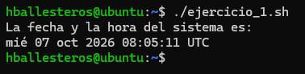
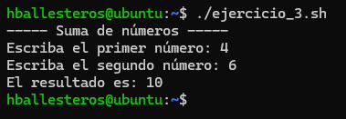
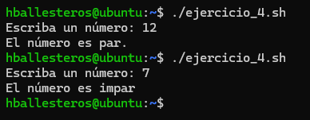
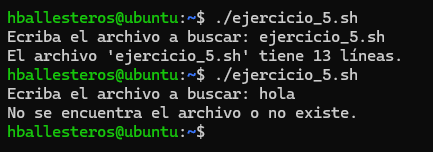
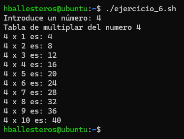
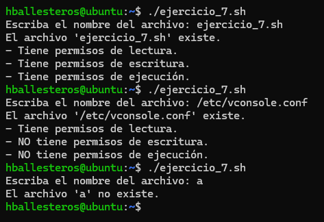
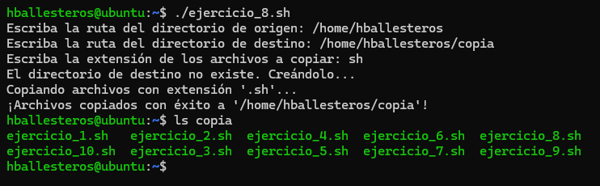
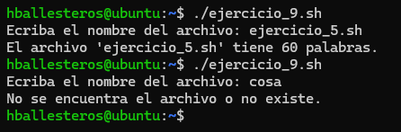
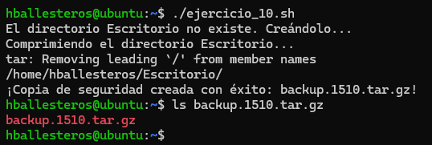

# PR0301: Primeros scripts en Bash

**1.** Crea un script que muestre por pantalla la fecha y la hora del sistema.

Script:
```bash
#!/bin/bash

echo -n "La fecha y la hora del sistema es:"
date
```

Resultado:



**2.** Mejora el script anterior para que muestre un mensaje de la forma: *“Hoy es jueves día 15 de abril y son las 12:00 horas”*.

Script:
```bash
#!/bin/bash

# Creamos las variables del día actual
dia_semana=$(date +"%A")        # %A - Nombre completo del día
dia_mes=$(date +"%d")           # %d - Día del mes en número
mes=$(date +"%B")               # %B - Nombre completo del mes
hora=$(date +"%R")              # %R - Formato de hora en 24h

# Resultado
echo "Hoy es $dia_semana día $dia_mes de $mes y son las $hora horas."
```

Resultado:


**3.** Crea un script que solicite la usuario dos números y luego imprima la suma de esos números.

Script:
```bash
#!/bin/bash

# Damos los valores para la suma
echo "----- Suma de números -----"
read -p "Escriba el primer número: " num1
read -p "Escriba el segundo número: " num2

# Cálculo de la suma de los valores
resultado=$((num1 + num2))

# Resultado
echo "El resultado es: $resultado"
```

Resultado:



**4.** Crea un script que determine si un número introducido por el usuario es par o impar.

Script:
```bash
#!/bin/bash

# Damos el valor al número
read -p "Escriba un número: " numero

# Cálculo de si es par o impar
if (( $numero % 2 == 0 )); then
  echo "El número es par."
else
  echo "El número es impar."
fi
```

Resultado:



**5.** Escribe un script que solicite el nombre de un archivo y luego imprima cuántas líneas tiene ese archivo. Verifica que el archivo exista antes de contar las líneas.

Script:
```bash
#!/bin/bash

# Escribimos el archivo que queremos buscar
read -p "Ecriba el archivo a buscar: " archivo

# Verificación de si el archivo existe
if [ -f "$archivo" ]; then
  # Contamos las líneas del archivo
  lineas=$( wc -l < "$archivo" )
  echo "El archivo '$archivo' tiene $lineas líneas."
else
  echo "No se encuentra el archivo o no existe."
fi
```

Resultado:



**6.** Escribe un script que imprima la tabla de multiplicar de un número introducido por el usuario.

Script:
```bash
#!/bin/bash

read -p "Introduce un número: " numero
echo "Tabla de multiplar del numero $numero"

# Creamos la tabla de multiplicación
for factor in {1..10}
do
  # La variable factor multplica del 1 al 10 por la variable numero
  resultado=$(( numero*factor ))
  echo "$numero x $factor es: $resultado"
done
```

Resultado:



**7.** Crea un script que solicite el nombre de un archivo y luego informe si el archivo tiene permisos de lectura, escritura y ejecución para el usuario actual.

Script:
```bash
#!/bin/bash

read -p "Escriba el nombre del archivo: " archivo

# Comprobamos si el archivo existe
if [ -e "$archivo" ]; then
  echo "El archivo '$archivo' existe."

  # 2. Comprobar lectura
  if [ -r "$archivo" ]; then
    echo "- Tiene permisos de lectura."
  else
    echo "- NO tiene permisos de lectura."
  fi

  # 3. Comprobar escritura
  if [ -w "$archivo" ]; then
    echo "- Tiene permisos de escritura."
  else
    echo "- NO tiene permisos de escritura."
  fi

  # 4. Comprobar ejecución
  if [ -x "$archivo" ]; then
    echo "- Tiene permisos de ejecución."
  else
    echo "- NO tiene permisos de ejecución."
  fi
else
  echo "El archivo '$archivo' no existe."
fi
```

Resultado:



**8.** Escribe un script que copie todos los archivos con una extensión específica desde un directorio de origen a uno de destino.

Script:
```bash
#!/bin/bash

# Solicitamos los datos necesarios
read -p "Escriba la ruta del directorio de origen: " origen
read -p "Escriba la ruta del directorio de destino: " destino
read -p "Escriba la extensión de los archivos a copiar: " ext

# Comprobamos si el directorio de destino existe, si no, lo creamos
if [ -d "$destino" ]; then
    echo "El directorio de destino no existe. Creándolo..."
    mkdir -p "$destino"
fi
echo "Copiando archivos con extensión '.$ext'..."

# Copiamos los archivos asegurándonos de filtrar la extensión
cp "$origen"/*."$ext" "$destino"/ 2>/dev/null

# Comprobamos el estado de salida del comando anterior
if [ $? -eq 0 ]; then
    echo "¡Archivos copiados con éxito a '$destino'!"
else
    echo "Aviso: El directorio de origen se ha creado pero está vacío o no hay archivos con esa extensión."
fi
```

Resultado:



**9.** Escribe un script que cuente cuántas palabras hay en un archivo y las muestre en la terminal.

Script:
```bash
#!/bin/bash

# Escribimos el archivo que queremos buscar
read -p "Ecriba el nombre del archivo: " archivo

# Verificación de si el archivo existe
if [ -f "$archivo" ]; then
  # Contamos las líneas del archivo
  palabras=$( wc -w < "$archivo" )
  echo "El archivo '$archivo' tiene $palabras palabras."
else
  echo "No se encuentra el archivo o no existe."
fi
```

Resultado:



**10.** Crea un script que comprima todos los ficheros del directorio Escritorio que está dentro del directorio personal del usuario actual en un fichero llamado backup.DDMM.gz donde DD es el día del mes y MM el mes. Para comprimir puedes utilizar el comando tar de la siguiente manera:
```bash
tar -zcvf nombre-archivo.tar.gz nombre-directorio
```

Script:
```bash
#!/bin/bash

# Obtenemos el día y el mes actual en formato DDMM
fecha=$(date +%d%m)

# Definimos el directorio de origen y el nombre del archivo de respaldo
origen="$HOME/Escritorio"
archivo_backup="backup.$fecha.tar.gz"

# Si el directorio no existe, lo creamos
if [ -d "$origen" ]; then
    echo "El directorio Escritorio no existe. Creándolo..."
    mkdir -p "$origen"
fi
echo "Comprimiendo el directorio Escritorio..."

# Comprimimos usando tar
tar -zcvf "$archivo_backup" "$origen"
echo "¡Copia de seguridad creada con éxito: $archivo_backup!"
```

Resultado:



[Volver a la página anterior](../index.md)