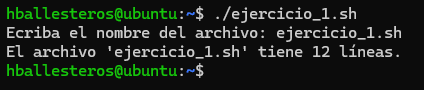
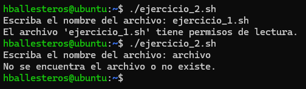
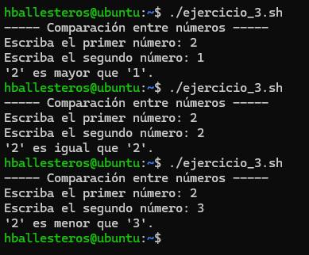
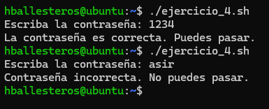
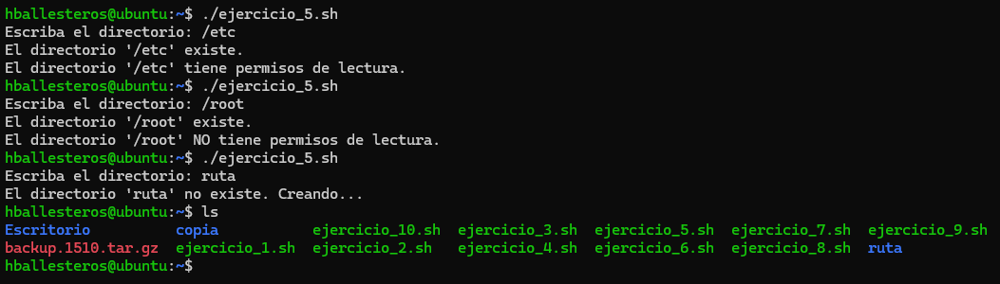
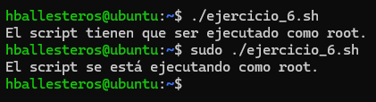
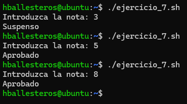
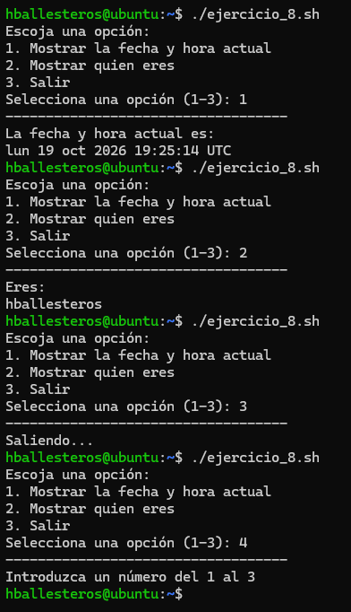
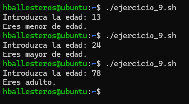

# PR0302: Condicional `if`

**1.** Escribe un script que solicite el nombre de un archivo y luego imprima cuántas líneas tiene ese archivo. Verifica que el archivo exista antes de contar las líneas.

Script:
```bash
#!/bin/bash

read -p "Ecriba el nombre del archivo: " archivo

# Verificar si el archivo existe
if [ -f "$archivo" ]; then
  # Contamos las líneas del archivo
  lineas=$( wc -l < "$archivo" )
  echo "El archivo '$archivo' tiene $lineas líneas."
else
  echo "No se encuentra el archivo o no existe."
fi
```

Resultado:



**2.** Crea un script que compruebe si un archivo (cuya ruta pedirá al usuario por teclado) existe y si tiene permisos de lectura. Muestra un mensaje adecuado para cada caso.

Script:
```bash
#!/bin/bash

read -p "Escriba el nombre del archivo: " archivo

# Verificar si el archivo existe
if [ -f "$archivo" ]; then
  # Comprobar lectura
  if [ -r "$archivo" ]; then
    echo "El archivo '$archivo' tiene permisos de lectura."
  else
    echo "El archivo '$archivo' NO tiene permisos de lectura."
  fi
  else
    echo "No se encuentra el archivo o no existe."
fi
```

Resultado:



**3.** Realiza un script que solicite dos números al usuario y los compare, mostrando cuál es mayor, o si son iguales.

Script:
```bash
#!/bin/bash

echo "----- Comparación entre números -----"

# Dar variables de los dos numeros
read -p "Escriba el primer número: " num1
read -p "Escriba el segundo número: " num2

# Comparacion entre dos numeros
if [ "$num1" -gt "$num2" ]; then
  echo "'$num1' es mayor que '$num2'."
elif [ "$num1" -eq "$num2" ]; then
    echo "'$num1' es igual que '$num2'."
else
    echo "'$num1' es menor que '$num2'."
fi
```

Resultado:



**4.** Escribe un script que solicite al usuario una contraseña y verifique si coincide con una contraseña predefinida (que estará almacenada en una variable de tu script). Si es correcta, muestra un mensaje de éxito, de lo contrario, indica que es incorrecta.

Script:
```bash
#!/bin/bash

# Creamos un valor para comprobar
contrasena=1234

read -p "Escriba la contraseña: " acceso

# Comprobamos que un valor dentro del script sea igual al otro
if [ "$acceso" = "$contrasena" ]; then
  echo "La contraseña es correcta. Puedes pasar."
else
  echo "Contraseña incorrecta. No puedes pasar."
fi
```

Resultado:



**5.** Crea un script que compruebe si un directorio (que solicitará por teclado al usuario) existe y si tiene permisos de escritura. Si el directorio no existe, crea uno nuevo.

Script:
```bash
#!/bin/bash

read -p "Escriba el directorio: " directorio

# Comprobar que el directorio existe
if  [ -d "$directorio" ]; then
  echo "El directorio '$directorio' existe."

  #Comprobamos que tenga permisos de lectura
  if [ -r "$directorio" ]; then
    echo "El directorio '$directorio' tiene permisos de lectura."
  else
    echo "El directorio '$directorio' NO tiene permisos de lectura."
  fi

# Creamos el directorio en caso de que no exista
else
  echo "El directorio '$directorio' no existe. Creando..."
  mkdir -p "$directorio"
fi
```

Resultado:



**6.** Haz un script que verifique si el script está siendo ejecutado por el usuario root, mostrando un mensaje diferente si no lo es.

Script:
```bash
#!/bin/bash

# El valor $EUID se refiere a root y tiene el valor 0
if [ "$EUID" -eq 0 ]; then
    echo "El script se está ejecutando como root."
else
    echo "El script tienen que ser ejecutado como root."
fi
```

Resultado:



**7.** Realiza un script que pida una nota numérica y determine si es “Aprobado” (5 o más) o “Suspenso” (menos de 5).

Script:
```bash
#!/bin/bash

read -p "Introduzca la nota: " nota

if [ "$nota" -ge 5 ]; then
  echo "Aprobado"
else
  echo "Suspenso"
fi
```

Resultado:



**8.** Escribe un script que muestre un menú con tres opciones. El usuario debe introducir una opción y el script debe ejecutar una acción diferente dependiendo de la opción seleccionada.

Script:
```bash
#!/bin/bash

# Mostrar menú de opciones
echo "Escoja una opción:"
echo "1. Mostrar la fecha y hora actual"
echo "2. Mostrar quien eres"
echo "3. Salir"

read -p "Selecciona una opción (1-3): " opcion

# Crear el caso para cada opción
case $opcion in

  # Para el caso 1, hará lo siguiente:
  1)
    echo "-----------------------------------"
    echo "La fecha y hora actual es:"
    date
    ;;
  # Para el caso 2, hará esto otro:
  2)
    echo "-----------------------------------"
    echo "Eres:"
    whoami
    ;;
  # Para el caso 3, será un mensaje de salida
  3)
    echo "-----------------------------------"
    echo "Saliendo..."
    ;;
  # * Sirve para aquellos otros elementos que no estén dentro del caso
  *)
    echo "-----------------------------------"
    echo "Introduzca un número del 1 al 3"
    ;;
esac
```

Resultado:



**9.** Haz un script que solicite al usuario su edad y determine si es menor, adulto o mayor de edad, según un umbral predefinido.

Script:
```bash
#!/bin/bash

read -p "Introduzca la edad: " edad

# Comprobacion de la edad
if [ $edad -lt 18 ]; then
  echo "Eres menor de edad."
elif [ $edad -le 65 ]; then
  echo "Eres mayor de edad."
else
  echo "Eres adulto."
fi
```

Resultado:



[Volver a la página anterior](../index.md)