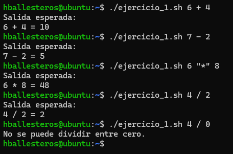

# PR0303: Parámetros en Bash

**1.** Crea un script que funcione como una calculadora de operaciones básicas. Si no se pasan parámetros, debe solicitar los valores al usuario. Debe manejar **errores**, como división por 0.

Script:
```bash
#!/bin/bash

# Damos valores para escribirlos junto /.script.sh
num1=$1
operacion=$2
num2=$3

# Creamos el caso para las operaciones
case $operacion in
  +)
    resultado=$(("$num1" + "$num2"))
    echo "Salida esperada:"
    echo "$num1 + $num2 = $resultado"
    ;;
  -)
    resultado=$(("$num1" - "$num2"))
    echo "Salida esperada:"
    echo "$num1 - $num2 = $resultado"
    ;;
  x|*)
    resultado=$(("$num1" * "$num2"))
    echo "Salida esperada:"
    echo "$num1 * $num2 = $resultado"
    ;;
  /)
    # Para que no se divida entre 0
    if [ "$num2" -eq 0 ]; then
      echo "No se puede dividir entre cero."
    else
      resultado=$(("$num1" / "$num2"))
      echo "Salida esperada:"
      echo "$num1 / $num2 = $resultado"
    fi
    ;;
esac
```

Resultado:



**2.** Crea un script que verifique si una dirección IP es válida. Si no se pasa, debe pedirla al usuario.

Script:
```bash
grep -E "^[0-9]{1,3}\.[0-9]{1,3}\.[0-9{1,3}]\.[0-9]{1,3}$"
```

Resultado:


**3.** Crea un script que cuente archivos de distintos tipos en un directorio. Debe recibir el directorio como **parámetro**, si no se pasara el parámetro, lo solicitará al usuario. Mostrará cuántos archivos hay de cada extensión.

Script:
```bash

```

Resultado:


**4.** Crea un script que realice una copia de seguridad de un directorio. Debe recibir el **directorio origen** y el **directorio destino** como parámetros. Si no se pasan, debe solicitarlos.

Script:
```bash
#!/bin/bash

# Creamos las variables de los directorios de origen y destino
# $# sirve para el total de parámetros que en este caso son 2
if [ $# -ne 2 ]; then
  read -p "Escriba el directorio de origen" origen
  read -p "Escriba el directorio de destino" destino
else
  origen=$1
  destino=$2
fi

# Creamos el archivo .tar con la fecha actual
# &> sirve para devolver los errores tanto en origen como en destino
fecha=$(date +%Y%m%d)
tar -cvzf $destino/backup$fecha.tar.gz $origen/* &> /dev/null

# Si no se ha creado la copia de seguridad
# $? es el comando anterior que hemos escrito
if [ $? -eq 0 ]; then
  echo "Copia de seguridad realizada."
else
  echo "Hubo un error al crear la copia de seguridad."
fi
```

Resultado:


**5.** Crea un script que convierta una temperatura entre **Celsius y Fahrenheit**. Debe recibir la temperatura y la unidad como parámetros (`C` o `F`). Si no se pasan, debe solicitarlos al usuario.

Script:
```bash

```

Resultado:


**6.** Crea un script que genere un nombre aleatorio para un archivo. Debe aceptar una **extensión** como parámetro. Si no se pasan, debe solicitarlos al usuario.

Script:
```bash

```

Resultado:


**7.** Crea un script que compare dos archivos y muestre las diferencias. Debe recibir los **dos archivos como parámetros**. Si no se pasan, debe solicitarlos.

Script:
```bash

```

Resultado:


**8.** Crea un script que genere un número aleatorio entre un mínimo y un máximo. Debe recibir los valores **mínimo y máximo** como parámetros. Si no se pasan, debe solicitarlos al usuario.

Script:
```bash

```

Resultado:


[Volver a la página anterior](../index.md)