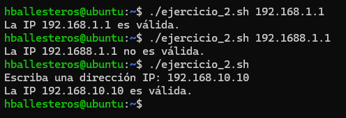
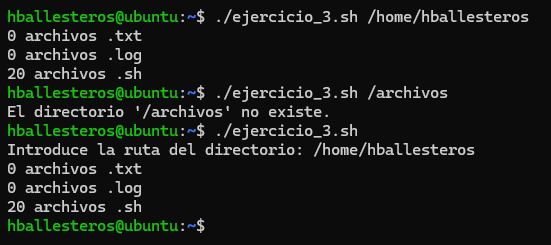
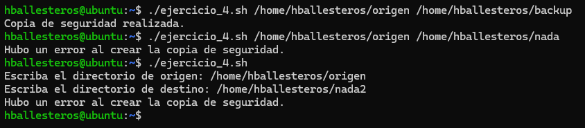
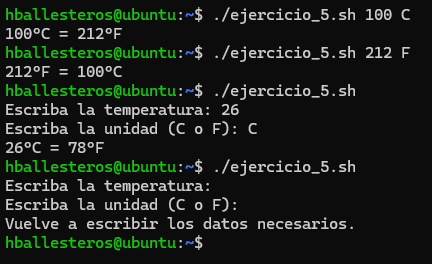
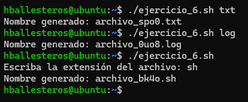
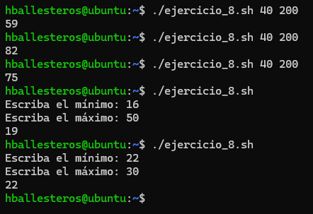

# PR0303: Parámetros en Bash

**1.** Crea un script que funcione como una calculadora de operaciones básicas. Si no se pasan parámetros, debe solicitar los valores al usuario. Debe manejar **errores**, como división por 0.

Script:
```bash
#!/bin/bash

# Creamos los parámetros
num1=$1
operacion=$2
num2=$3

# Si no escribimos nada, lo pedirá
read -p "Escriba el primer número: " num1
read -p "Escriba la operación: " operacion
read -p "Escriba el segundo número: " num2

# Creamos el caso para las operaciones
case $operacion in
  +)
    resultado=$(("$num1" + "$num2"))
    echo "$num1 + $num2 = $resultado"
    ;;
  -)
    resultado=$(("$num1" - "$num2"))
    echo "$num1 - $num2 = $resultado"
    ;;
  /)
    # Para que no se divida entre 0
    if [ "$num2" -eq 0 ]; then
      echo "No se puede dividir entre cero."
    else
      resultado=$(("$num1" / "$num2"))
      echo "$num1 / $num2 = $resultado"
    fi
    ;;
  *)
    # Al ejecutar, pondremos "*" para evitar errores
    resultado=$(("$num1" * "$num2"))
    echo "$num1 * $num2 = $resultado"
    ;;
esac
```

Resultado:


**2.** Crea un script que verifique si una dirección IP es válida. Si no se pasa, debe pedirla al usuario.

Script:
```bash
#!/bin/bash

# Creamos el parámetro
ip=$1

# Si no escribimos nada, lo pedirá
if [ -z "$ip" ]; then
    read -p "Escriba una dirección IP: " ip
fi

# Validamos con grep el formato X.X.X.X
if echo "$ip" | grep -E -q "^[0-9]{1,3}\.[0-9]{1,3}\.[0-9]{1,3}\.[0-9]{1,3}$"; then
    echo "La IP $ip es válida."
else
    echo "La IP $ip no es válida."
fi
```

Resultado:



**3.** Crea un script que cuente archivos de distintos tipos en un directorio. Debe recibir el directorio como **parámetro**, si no se pasara el parámetro, lo solicitará al usuario. Mostrará cuántos archivos hay de cada extensión.

Script:
```bash
#!/bin/bash

# Creamos el parámetro
directorio="$1"

# Si no escribimos nada, lo pedirá
if [ -z "$directorio" ]; then
    read -p "Introduce la ruta del directorio: " directorio
fi

# Comprobamos si el directorio existe
if [ -d "$directorio" ]; then

    # Usamos find para buscar los archivos y grep para filtrar por extensión
    txt=$(find "$directorio" -type f | grep -E "\.txt$" | wc -l)
    log=$(find "$directorio" -type f | grep -E "\.log$" | wc -l)
    sh=$(find "$directorio" -type f | grep -E "\.sh$" | wc -l)

    # Resultados
    echo "$txt archivos .txt"
    echo "$log archivos .log"
    echo "$sh archivos .sh"
else
    echo "El directorio '$directorio' no existe."
fi
```

Resultado:




**4.** Crea un script que realice una copia de seguridad de un directorio. Debe recibir el **directorio origen** y el **directorio destino** como parámetros. Si no se pasan, debe solicitarlos.

Script:
```bash
#!/bin/bash

# Creamos las variables de los directorios de origen y destino
# $# sirve para el total de parámetros que en este caso son 2
if [ $# -ne 2 ]; then
  read -p "Escriba el directorio de origen: " origen
  read -p "Escriba el directorio de destino: " destino
else
  origen=$1
  destino=$2
fi

# Creamos el archivo .tar con la fecha actual
# &> sirve para devolver los errores tanto en origen como en destino
fecha=$(date +%Y%m%d)
tar -cvzf "$destino/backup$fecha.tar.gz" "$origen/"* &> /dev/null

# Si no se ha creado la copia de seguridad
# $? es el comando anterior que hemos escrito
if [ $? -eq 0 ]; then
  echo "Copia de seguridad realizada."
else
  echo "Hubo un error al crear la copia de seguridad."
fi
```

Resultado:



**5.** Crea un script que convierta una temperatura entre **Celsius** y **Fahrenheit**. Debe recibir la temperatura y la unidad como parámetros (`C` o `F`). Si no se pasan, debe solicitarlos al usuario.

Script:
```bash
#!/bin/bash

# Creamos los parámetros
temp=$1
unidad=$2

# Si no escribimos nada, lo pedirá
if [ -z "$temp" ] || [ -z "$unidad" ]; then
    read -p "Escriba la temperatura: " temp
    read -p "Escriba la unidad (C o F): " unidad
fi

# Conversor de la tamperatura
if [ "$unidad" = "C" ]; then
    # Conversión de Celsius a Fahrenheit: (C * 9/5) + 32
    resultado=$(( ("$temp" * 9/5) + 32 ))
    echo "$temp°C = $resultado°F"
elif [ "$unidad" = "F" ]; then
    # Conversión de Fahrenheit a Celsius: (F - 32) * 5/9
    resultado=$(( ("$temp" - 32) * 5/9 ))
    echo "$temp°F = $resultado°C"
else
    echo "Vuelve a escribir los datos necesarios."
fi
```

Resultado:



**6.** Crea un script que genere un nombre aleatorio para un archivo. Debe aceptar una **extensión** como parámetro. Si no se pasan, debe solicitarlos al usuario.

Script:
```bash
#!/bin/bash

# Creamos el parámetro
extension=$1

# Si no escribimos nada, lo pedirá
if [ -z "$extension" ]; then
    read -p "Escriba la extensión del archivo: " extension
fi

# Generamos la cadena aleatoria corta usando /dev/urandom
rand_str=$(tr -dc 'a-z0-9' < /dev/urandom | head -c 4)

# Resultado
echo "Nombre generado: archivo_$rand_str.$extension"
```

Resultado:



**7.** Crea un script que compare dos archivos y muestre las diferencias. Debe recibir los **dos archivos como parámetros**. Si no se pasan, debe solicitarlos.

Script:
```bash
#!/bin/bash

# Creamos los parámetros
archivo1=$1
archivo2=$2

# Si no escribimos nada, lo pedirá
if [ -z "$archivo1" ]; then
    read -p "Escriba la ruta del primer archivo: " archivo1
fi
if [ -z "$archivo2" ]; then
    read -p "Escriba la ruta del segundo archivo: " archivo2
fi

# Comprobamos que ambos archivos existan
if [ -f "$archivo1" ] && [ -f "$archivo2" ]; then
    # Si los dos existen, usamos diff para comparar y mostrar diferencias
    echo "Diferencias encontradas:"
    diff -u "$archivo1" "$archivo2"
else
    echo "Uno de los archivos no existe o está mal escrito."
fi
```

Resultado:


**8.** Crea un script que genere un número aleatorio entre un mínimo y un máximo. Debe recibir los valores **mínimo y máximo** como parámetros. Si no se pasan, debe solicitarlos al usuario.

Script:
```bash
#!/bin/bash

# Creamos los parámetros
min=$1
max=$2

# Si no escribimos nada, lo pedirá
if [ "$#" -ne 2 ]; then
  read -p "Escriba el mínimo: " min
  read -p "Escriba el máximo: " max
fi

diferencia=$(("$max" - "$min"))
resto=$(("$RANDOM" % "$diferencia"))
resultado=$(("$resto" + "$min"))

echo "$resultado"
```

Resultado:



[Volver a la página anterior](../index.md)