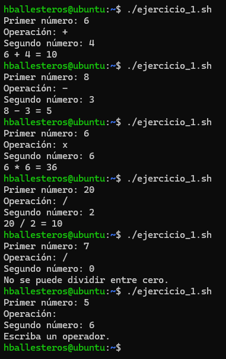
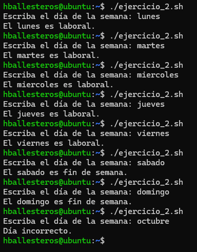
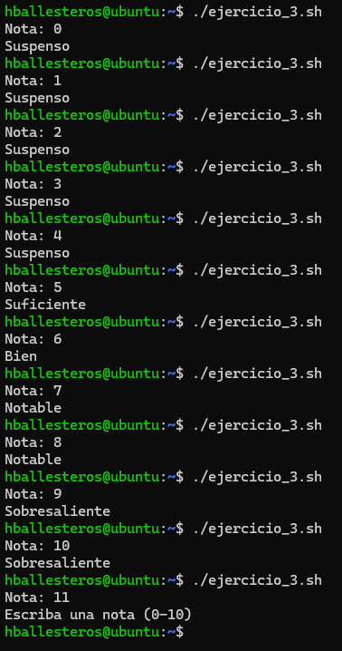
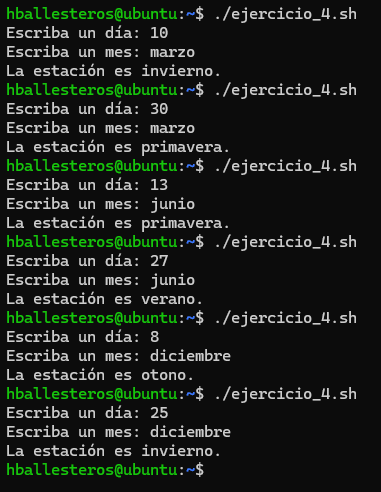
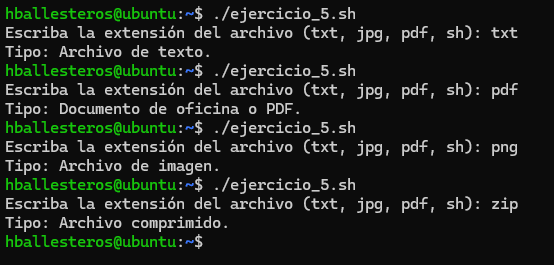
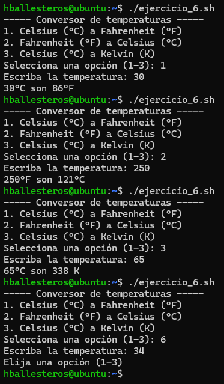
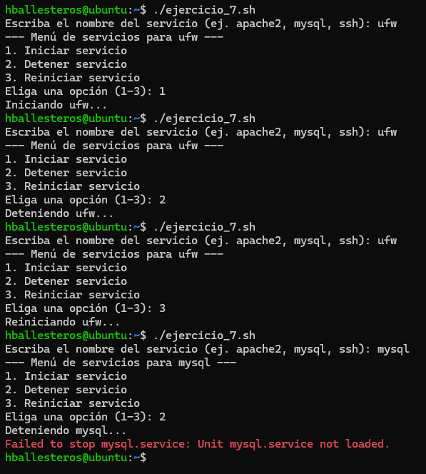
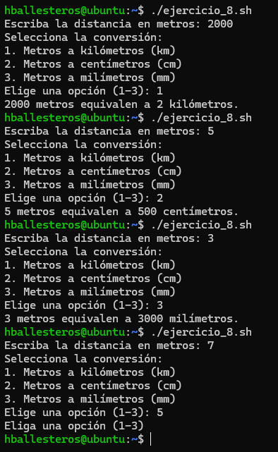

# PR0304: El comando `case`

**1.** Crea un script que muestre un menú con opciones para sumar, restar, multiplicar y dividir dos números. Debe pedir primero un operando, luego el otro y finalmente la operación a realizar. Usa `case` para realizar la operación seleccionada por el usuario.

Script:
```bash
#!/bin/bash

# Creamos los valores para calcular
read -p "Primer número: " num1
read -p "Operación: " operacion
read -p "Segundo número: " num2

# Creamos el caso para las operaciones
case $operacion in
  +)
    resultado=$(("$num1" + "$num2"))
    echo "$num1 + $num2 = $resultado"
    ;;
  -)
    resultado=$(("$num1" - "$num2"))
    echo "$num1 - $num2 = $resultado"
    ;;
  /)
    # Para que no se divida entre 0
    if [ "$num2" -eq 0 ]; then
      echo "No se puede dividir entre cero."
    else
      resultado=$(("$num1" / "$num2"))
      echo "$num1 / $num2 = $resultado"
    fi
    ;;
  x)
    resultado=$(("$num1" * "$num2"))
    echo "$num1 * $num2 = $resultado"
    ;;
  *)
      echo "Escriba un operador."
    ;;
esac
```

Resultado:



**2.** Haz un script que lea un día de la semana como entrada y responda si es un día laboral o de fin de semana.

Script:
```bash
#!/bin/bash

read -p "Escriba el día de la semana: " dia

case $dia in
  lunes | martes | miercoles | jueves | viernes)
    echo "El $dia es laboral."
    ;;
  sabado | domingo)
    echo "El $dia es fin de semana."
    ;;
  *)
    echo "Día incorrecto."
    ;;
esac
```

Resultado:



**3.** Crea un script que reciba una calificación numérica del 0 al 10 e indique la nota correspondiente: sobresaliente (9 o 10), notable (7 u 8), bien (6), suficiente (5) o suspenso (0 a 4).

Script:
```bash
#!/bin/bash

read -p "Nota: " nota

case $nota in
  0|1|2|3|4)
    echo "Suspenso"
    ;;
  5)
    echo "Suficiente"
    ;;
  6)
    echo "Bien"
    ;;
  7|8)
    echo "Notable"
    ;;
  9|10)
    echo "Sobresaliente"
    ;;
  *)
    echo "Escriba una nota (0-10)"
    ;;
esac
```

Resultado:



**4.** El usuario ingresa un mes del año, y el script responde con la estación correspondiente (primavera, verano, otoño o invierno).

Script:
```bash
#!/bin/bash

read -p "Escriba un día: " dia
read -p "Escriba un mes: " mes

case $mes in
  enero | febrero)
    estacion=invierno
    ;;
  marzo)
    if [ "$dia" -lt 21 ]; then
      estacion=invierno
    else
      estacion=primavera
    fi
    ;;
  abril | mayo)
    estacion=primavera
    ;;
  junio)
    if [ "$dia" -lt 21 ]; then
      estacion=primavera
    else
      estacion=verano
    fi
    ;;
  julio | agosto)
    estacion=verano
    ;;
  septiembre)
    if [ "$dia" -lt 21 ]; then
      estacion=verano
    else
      estacion=otono
    fi
    ;;
  octubre | noviembre)
    estacion=otono
    ;;
  diciembre)
    if [ "$dia" -lt 21 ]; then
      estacion=otono
    else
      estacion=invierno
    fi
    ;;
  *)
    echo "Día y mes incorrectos."
    ;;
esac

echo "La estación es $estacion."
```

Resultado:



**5.** Pide al usuario que ingrese la extensión de un archivo (.txt, .jpg, .pdf, etc.), y usa `case` para mostrar el tipo de archivo (texto, imagen, documento, etc.).

Script:
```bash
#!/bin/bash

read -p "Escriba la extensión del archivo (txt, jpg, pdf, sh): " extension

case $extension in
  txt|log)
    echo "Tipo: Archivo de texto."
    ;;
  jpg|png)
    echo "Tipo: Archivo de imagen."
    ;;
  pdf|docx)
    echo "Tipo: Documento de oficina o PDF."
    ;;
  zip|tar|rar)
    echo "Tipo: Archivo comprimido."
    ;;
  *)
    echo "No se conoce la extensión."
    ;;
esac
```

Resultado:



**6.** Haz un script que convierta una temperatura ingresada por el usuario de Celsius a Fahrenheit, de Fahrenheit a Celsius o de Celsius a Kelvin, usando `case` para seleccionar la conversión deseada.

Script:
```bash
#!/bin/bash

echo "----- Conversor de temperaturas -----"
echo "1. Celsius (°C) a Fahrenheit (°F)"
echo "2. Fahrenheit (°F) a Celsius (°C)"
echo "3. Celsius (°C) a Kelvin (K)"
read -p "Selecciona una opción (1-3): " opcion

read -p "Escriba la temperatura: " temp

case $opcion in
  1)
    # Fórmula: (C * 9/5) + 32
    resultado=$(( (temp * 9 / 5) + 32 ))
    echo "$temp°C son $resultado°F"
    ;;
  2)
    # Fórmula: (F - 32) * 5/9
    resultado=$(( ((temp - 32) * 5) / 9 ))
    echo "$temp°F son $resultado°C"
    ;;
  3)
    # Fórmula: C + 273
    resultado=$(( temp + 273 ))
    echo "$temp°C son $resultado K"
    ;;
  *)
    echo "Elija una opción (1-3)"
    ;;
esac
```

Resultado:



**7.** Escribe un script que reciba el nombre de un servicio (por ejemplo, “apache” o “mysql”) y, usando `case`, muestre opciones para iniciar, detener o reiniciar el servicio.

Script:
```bash
#!/bin/bash

read -p "Escriba el nombre del servicio (ej. apache2, mysql, ssh): " servicio

echo "--- Menú de servicios para $servicio ---"
echo "1. Iniciar servicio"
echo "2. Detener servicio"
echo "3. Reiniciar servicio"

read -p "Eliga una opción (1-3): " opcion

case $opcion in
  1)
    echo "Iniciando $servicio..."
    sudo systemctl start "$servicio"
    ;;
  2)
    echo "Deteniendo $servicio..."
    sudo systemctl stop "$servicio"
    ;;
  3)
    echo "Reiniciando $servicio..."
    sudo systemctl restart "$servicio"
    ;;
  *)
    echo "El servicio no existe o está mal escrito"
    ;;
esac
```

Resultado:




**8.** Desarrolla un script que permita al usuario convertir metros a kilómetros, metros a centímetros, o metros a milímetros, utilizando `case` para manejar cada opción de conversión.

Script:
```bash
#!/bin/bash

read -p "Escriba la distancia en metros: " metros

echo "Selecciona la conversión:"
echo "1. Metros a kilómetros (km)"
echo "2. Metros a centímetros (cm)"
echo "3. Metros a milímetros (mm)"
read -p "Elige una opción (1-3): " opcion

case $opcion in
  1)
    # Metros a Kilómetros
    resultado=$(( metros / 1000 ))
    echo "$metros metros equivalen a $resultado kilómetros."
    ;;
  2)
    # Metros a Centímetros
    resultado=$(( metros * 100 ))
    echo "$metros metros equivalen a $resultado centímetros."
    ;;
  3)
    # Metros a Milímetro
    resultado=$(( metros * 1000 ))
    echo "$metros metros equivalen a $resultado milímetros."
    ;;
  *)
    echo "Eliga una opción (1-3)"
    ;;
esac
```

Resultado:



[Volver a la página anterior](../index.md)