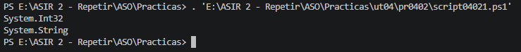
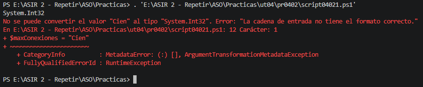
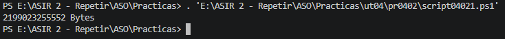
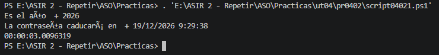

# PR0402: Variables, tipos de datos y colecciones en Powershell
Para esta práctica, los scripts se llamarán `script` con el número de la práctica `0402` seguido del número del bloque, por ejemplo: `script04025.ps1`.

## Bloque 1: Tipado dinámico, estático y tipos básicos
**1.** Declara una variable llamada `$recurso` y asígnale el valor numérico `8080`. Muestra por pantalla el nombre de su tipo de dato. A continuación, en la línea siguiente, asígnale la cadena `"Puerto HTTP"` a esa misma variable y vuelve a mostrar su tipo de dato.

Resultado:



**2.** Declara con tipado estático una variable entera llamada `$maxConexiones` con valor 100 y una variable booleana llamada `$firewallActivo` con valor `$true`. Escribe en un comentario qué error exacto devuelve PowerShell si intentas ejecutar `$maxConexiones = "Cien"`.

Error:
```
No se puede convertir el valor "Cien" al tipo "System.Int32". Error: "La cadena de entrada no tiene el formato correcto."
En E:\ASIR 2 - Repetir\ASO\Practicas\ut04\pr0402\script04021.ps1: 10 Carácter: 1
+ [int]$maxConexiones = "Cien"
+ ~~~~~~~~~~~~~~~~~~~~~~~~~~~~
    + CategoryInfo          : MetadataError: (:) [], ArgumentTransformationMetadataException
    + FullyQualifiedErrorId : RuntimeException
```



**3.** Declara una variable `$tamanoBackup` que almacene el valor de 2 Terabytes expresado en bytes (`2199023255552`) forzando el tipo `Int64` mediante su sufijo correspondiente (`L`) o mediante cast `[long]`.

Declara dos variables de alta precisión (`[decimal]` o sufijo `d`): `$costeLicencia = 149.95d` y `$iva = 31.49d`. Calcula la suma de ambas en `$totalFactura` y muéstrala por pantalla.



**4.** Guarda la fecha y hora actual en `$fechaActual`. Muestra por pantalla un mensaje que indique el año actual (`.Year`) y la fecha exacta en la que caducará una contraseña si vence dentro de **45 días** (`.AddDays()`).

Simula una tarea midiendo su duración: captura la fecha en `$inicio`, ejecuta una pausa de 3 segundos con `Start-Sleep -Seconds 3`, captura la fecha en `$fin` y almacena la resta de ambas en una variable de tipo `[TimeSpan]$tiempoTotal`. Muestra por pantalla los segundos totales transcurridos (`.TotalSeconds`).



[Volver a la página anterior](../index.md)