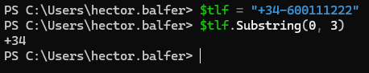
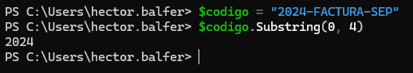
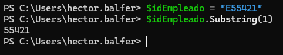
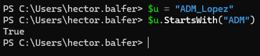
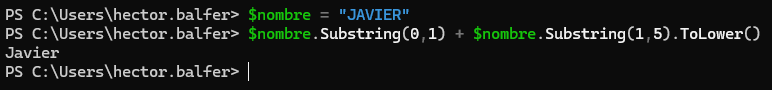
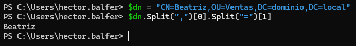
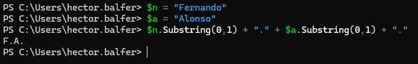

# PR0403: Manipulación de cadenas

## Ejercicio 1: Limpieza básica (mayúsculas, minúsculas y espacios)
**1.** Normalizar a mayúsculas
- **Entrada:** `$sys = "Windows Server"`
- **Salida:** `WINDOWS SERVER`


**2.** Normalizar a minúsculas
- **Entrada:** `"ADMINISTRADOR"`
- **Salida:** `administrador`


**3.** Limpieza de espacios extremos
- **Entrada:** `$ip = " 192.168.1.10 "`
- **Salida:** `192.168.1.10`


**4.** Eliminación total de espacios
- **Entrada:** `$mac = "00 AA 11 BB 22 CC"`
- **Salida:** `00AA11BB22CC`


**5.** Longitud de la cadena
- **Entrada:** `$pass = "P@ssw0rd123"`
- **Salida:** `11`


## Ejercicio 2: Reemplazo y sustitución
**6.** Cambio de separadores de fecha
- **Entrada:** `$fecha = "2023.10.05"`
- **Salida:** `2023-10-05`


**7.** Actualización de dominio
- **Entrada:** `$web = "www.miempresa.es"`
- **Salida:** `www.miempresa.com`


**8.** Censura de datos
- **Entrada:** `$tarjeta = "1234-5678-9012-3456"`
- **Salida:** `1234-5678-9012-XXXX`


**9.** Cambio de barra de rutas (Linux a Windows)
- **Entrada:** `$rutaLinux = "/home/usuario/docs"`
- **Salida:** `\home\usuario\docs`


**10.** Doble reemplazo (limpiar prefijo y sufijo)
- **Entrada:** `$valor = "(Software)"`
- **Salida:** `Software`


## Ejercicio 3: Extracción por posición
**11.** Extraer prefijo de país
- **Entrada:** `$tlf = "+34-600111222"`
- **Salida:** `+34`



**12.** Extraer año fiscal (primeros 4 caracteres)
- **Entrada:** `$codigo = "2024-FACTURA-SEP"`
- **Salida:** `2024`



**13.** Ignorar el primer carácter
- **Entrada:** `$idEmpleado = "E55421"`
- **Salida:** `55421`



**14.** Extraer extensión de archivo (últimos 3)
- **Entrada:** `$fichero = "informe.pdf"`
- **Salida:** `pdf`


**15.** Relleno de ceros (Padding)
- **Entrada:** `$numero = "7"`
- **Salida:** `007`


## Ejercicio 4: Troceado (Split) y arrays
**16.** Obtener nombre de usuario desde email
- **Entrada:** `$email = "pepe.garcia@empresa.com"`
- **Salida:** `pepe.garcia`


**17.** Obtener dominio desde email
- **Entrada:** `$email = "pepe.garcia@empresa.com"`
- **Salida:** `empresa.com`


**18.** Obtener nombre de archivo de una ruta larga
- **Entrada:** `$path = "C:\Users\Admin\Downloads\instaler.msi"`
- **Salida:** `instaler.msi`


**19.** Obtener letra de unidad
- **Entrada:** `$path = "D:\Datos\Backups"`
- **Salida:** `D:`


**20.** Separar CSV manual
- **Entrada:** `$linea = "Juan;Marketing;Madrid"`
- **Salida:** `Marketing`


## Ejercicio 5: Aplicaciones prácticas
**21.** Detección de usuario Admin (Boolean). Devuelve `True` si empieza por “ADM”, `False` si no.
- **Entrada:** `$u = "ADM_Lopez"`
- **Salida:** `True`



**22.** Formato de nombre propio. Convierte la primera letra en mayúscula y el resto en minúscula.
- **Entrada:** `$nombre = "JAVIER"`
- **Salida:** `Javier`



**23.** Limpieza de Distinguished Name (AD). Extrae el nombre común (CN).
- **Entrada:** `$dn = "CN=Beatriz,OU=Ventas,DC=dominio,DC=local"`
- **Salida:** `Beatriz`



**24.** Generador de iniciales
- **Entrada:**

```powershell
$n = "Fernando"
$a = "Alonso"
```

- **Salida:** `F.A.`



**25.** 
- **Entrada:** `$euDate = "31-12-2023"`
- **Salida:** `20231231`


[Volver a la página anterior](../index.md)