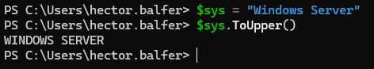
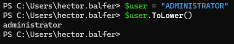
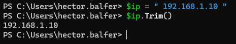
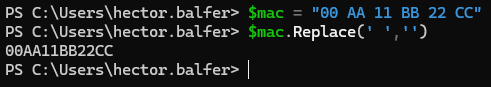
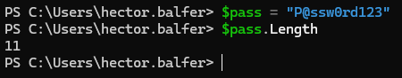
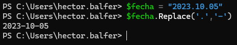
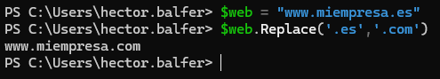
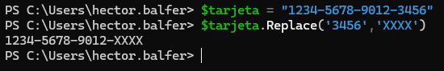
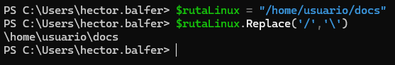
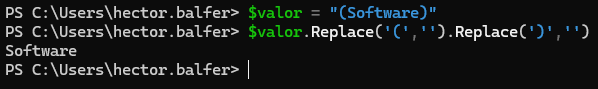

# PR0403: Manipulación de cadenas

## Ejercicio 1: Limpieza básica (mayúsculas, minúsculas y espacios)
**1.** Normalizar a mayúsculas
- **Entrada:** `$sys = "Windows Server"`
- **Salida:** `WINDOWS SERVER`

**2.** Normalizar a minúsculas
- **Entrada:** `"ADMINISTRADOR"`
- **Salida:** `administrador`

**3.** Limpieza de espacios extremos
- **Entrada:** `$ip = " 192.168.1.10 "`
- **Salida:** `192.168.1.10`

**4.** Eliminación total de espacios
- **Entrada:** `$mac = "00 AA 11 BB 22 CC"`
- **Salida:** `00AA11BB22CC`

**5.** Longitud de la cadena
- **Entrada:** `$pass = "P@ssw0rd123"`
- **Salida:** `11`

## Ejercicio 2: Reemplazo y sustitución
**6.** Cambio de separadores de fecha
- **Entrada:** `$fecha = "2023.10.05"`
- **Salida:** `2023-10-05`

**7.** Actualización de dominio
- **Entrada:** `$web = "www.miempresa.es"`
- **Salida:** `www.miempresa.com`

**8.** Censura de datos
- **Entrada:** `$tarjeta = "1234-5678-9012-3456"`
- **Salida:** `1234-5678-9012-XXXX`

**9.** Cambio de barra de rutas (Linux a Windows)
- **Entrada:** `$rutaLinux = "/home/usuario/docs"`
- **Salida:** `\home\usuario\docs`

**10.** Doble reemplazo (limpiar prefijo y sufijo)
- **Entrada:** `$valor = "(Software)"`
- **Salida:** `Software`

## Ejercicio 3: Extracción por posición

[Volver a la página anterior](../index.md)