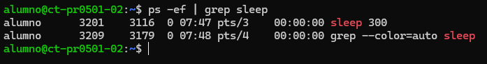
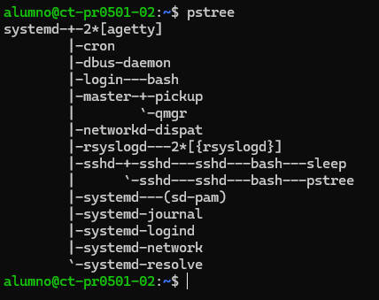
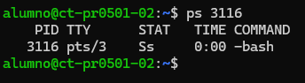
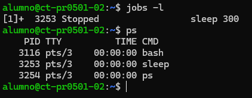
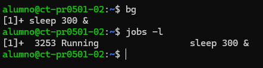
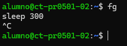
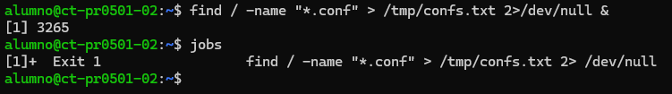
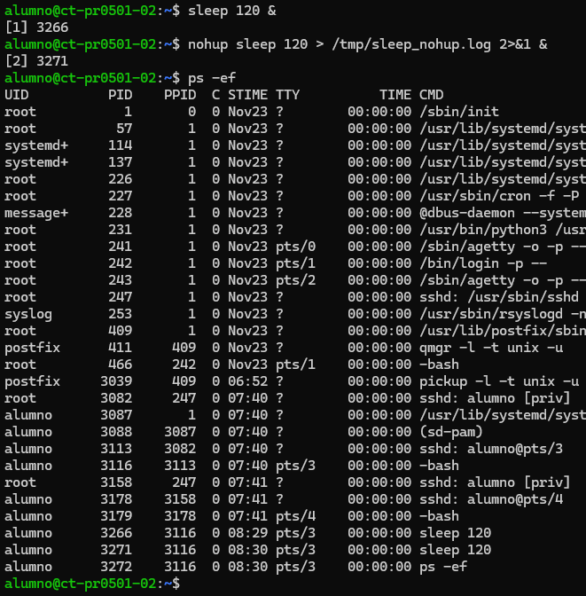

# PR0501: Disagnóstico y control de procesos en Linux

## Fase 1. Identificación, parentesco y jerarquía de los procesos
**1.** Abrimos dos terminales y nos conectamos por SSH.  
**2.** Desde la terminal 1, pondremos el comando `sleep 300`.  
**3.** En la terminal 2, pondremos el comando `ps -ef | grep sleep` para ver solamente el comando sleep ejecutado.



El `PID` es **3201** y el `PPID` es **3116**. La segunda línea aparece porque hemos puesto `grep sleep`.

**4.** Al poner el comando `pstree`, veremos aparte del proceso que hemos escrito, el proceso de sleep porque se está ejecutando en la otra terminal.



**5.**  
- El `PID` es el identificador del proceso mientras que el `PPID`, si ponemos el comando `ps 3116` veremos que pertenece a Bash.



- Procesos encontrados con `TTY` con `?`:

```
UID          PID    PPID  C STIME TTY      TIME     CMD
systemd+     114       1  0 Nov23 ?        00:00:00 /usr/lib/systemd/systemd-networkd
systemd+     137       1  0 Nov23 ?        00:00:00 /usr/lib/systemd/systemd-resolved
```

Que tenga un símbolo de interrogación, significa que no tiene una terminal asociada.

## Fase 2. Primer plano, segundo plano y control de trabajos
**1.** Desde la terminal 1, pulsamos `Ctrl + Z` para parar el proceso.  
**2.** Ponemos los comandos `jobs -l` y `ps`.



**3.** Si escribimos el comando `bg`, volveremos a ejecutar el proceso pausado pero en segundo plano.



**4.** Ahora, pondremos el comando `fg` para pasar el proceso de segundo plano a primer plano y lo cancelamos con `Ctrl + C`.



**5.** Mandamos una tarea a ejecutarse en segundo plano.



Al comprobarlo con el comando `jobs`, veremos que sale `Exit 1`. Esto quiere decir que sí se está ejecutando en segundo plano, si fuera en primer plano, saldría `Running`.

**6.** Ejecutamos el proceso en segundo plano y después con `nohup` lo protegemos frente al cierre de sesión. Después al comprobarlo con `ps -ef`, veremos al final que se están ejecutando.



**7.**
- Al suspender el proceso con `Ctrl + Z`, veremos que pone `Stopped` porque no se ha cancelado, si no guardado para volverse a ejecutar más tarde. Al ejecutar el comando `bg`, pasaremos los procesos parados a ejecutarse en segundo plano.
- El comando `nohup`, alterna procesos entre primer y segundo plano o los desvincula de la terminal. Es habitual redirigir porque si ejecutamos `nohup + comando`, crea un archivo en el directorio en el que nos encontremos.

## Fase 3. Monitorización en vivo y prioridades (`top`/`htop`,`nice`,`renice`)


[Volver a la página anterior](../index.md)