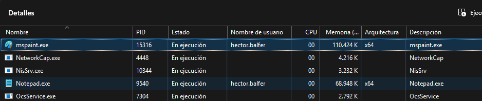

# PR0502: Inspección, control y diagnóstico de procesos en Windows

## Fase 1. Vista orientada al usuario frente a vista técnica
**1.** Abrimos dos aplicaciones, por ejemplo el Bloc de notas y Paint. Abrimos el Administrador de tareas y vamos al apartado de `Detalles` que tiene el icono de menú de hamburguesa.  
**2.** Apuntamos lo siguiente:
- **Nombre de proceso:** mspaint.exe, notepad.exe
- **PID:** 15316, 9540
- **Usuario propietario:** hector.balfer 
- **Estado actual:** En ejecución

- ¿Qué diferencia hay entre la información y organización que ofrece la pestaña *Procesos* frente a la pestaña *Detalles*?  
En el apartado de **Procesos**, veremos solamente los procesos que tiene el sistema junto a su consumo actual mientras que el apartado de **Detalles**, veremos toda la información del programa, como el ID que puede tener, que usuario lo está ejecutando, o saber su estado actual.

- ¿Qué significa el estado *Suspendido* cuando aparece en algunas aplicaciones modernas o en segundo plano?  
Significa que realmente sí que se está ejecutando pero no tiene la prioridad necesaria para salir en primer plano.

[Volver a la página anterior](../index.md)